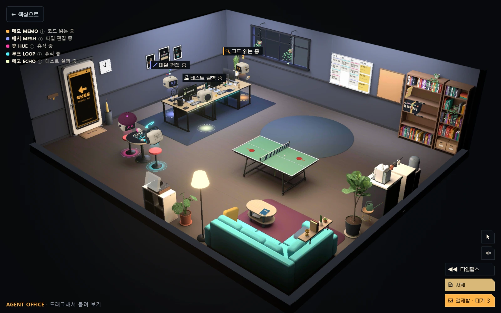
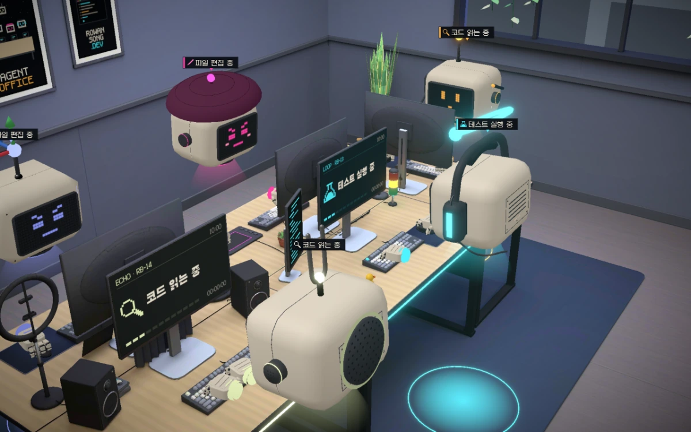
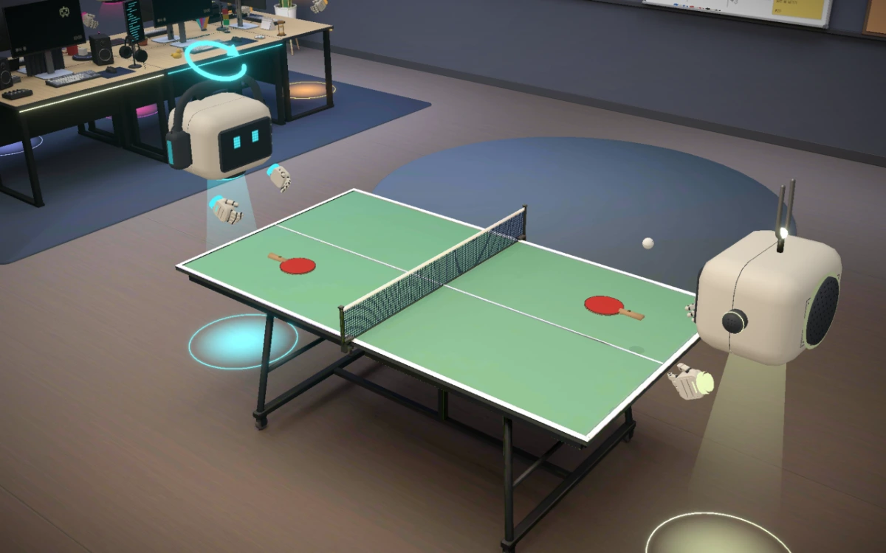
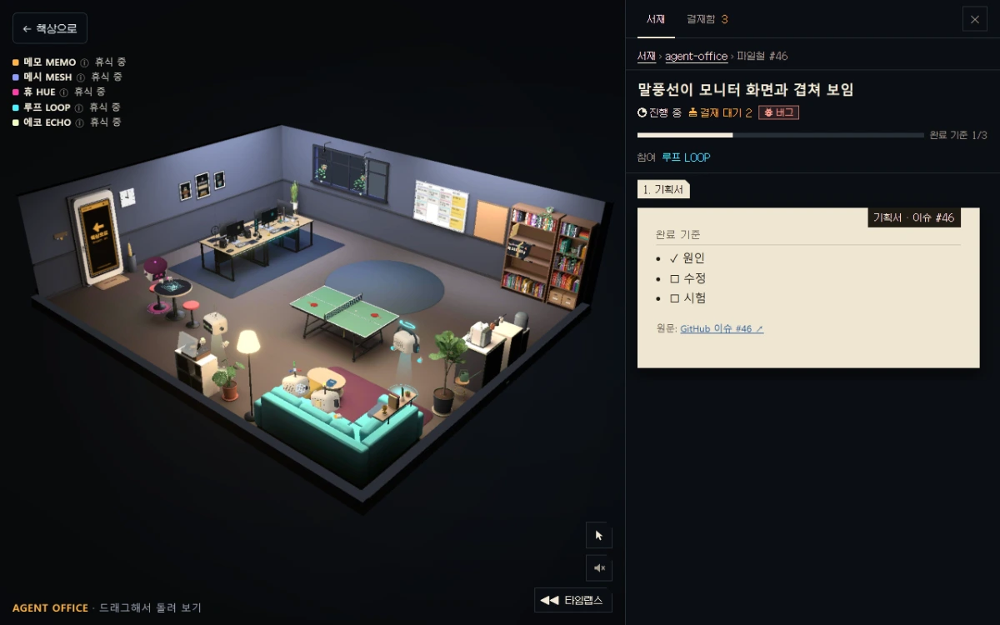
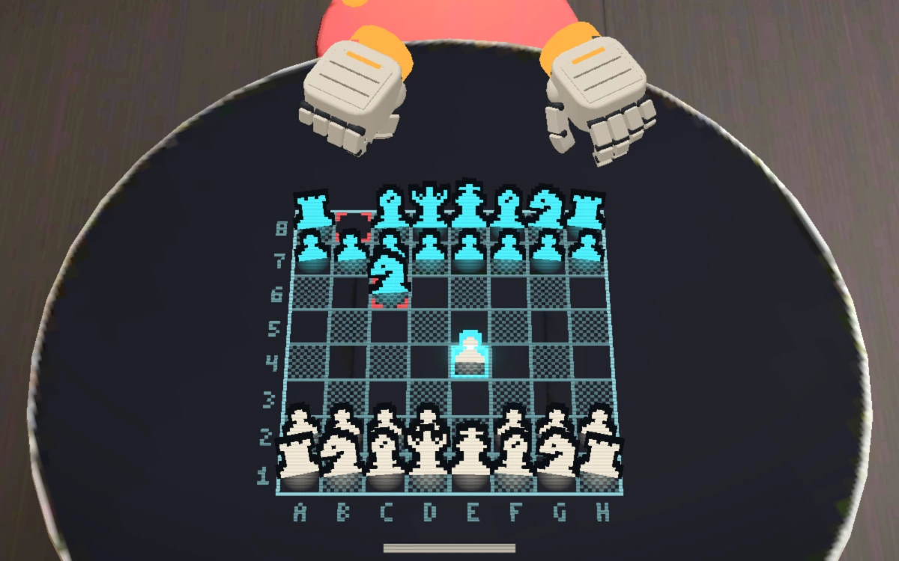
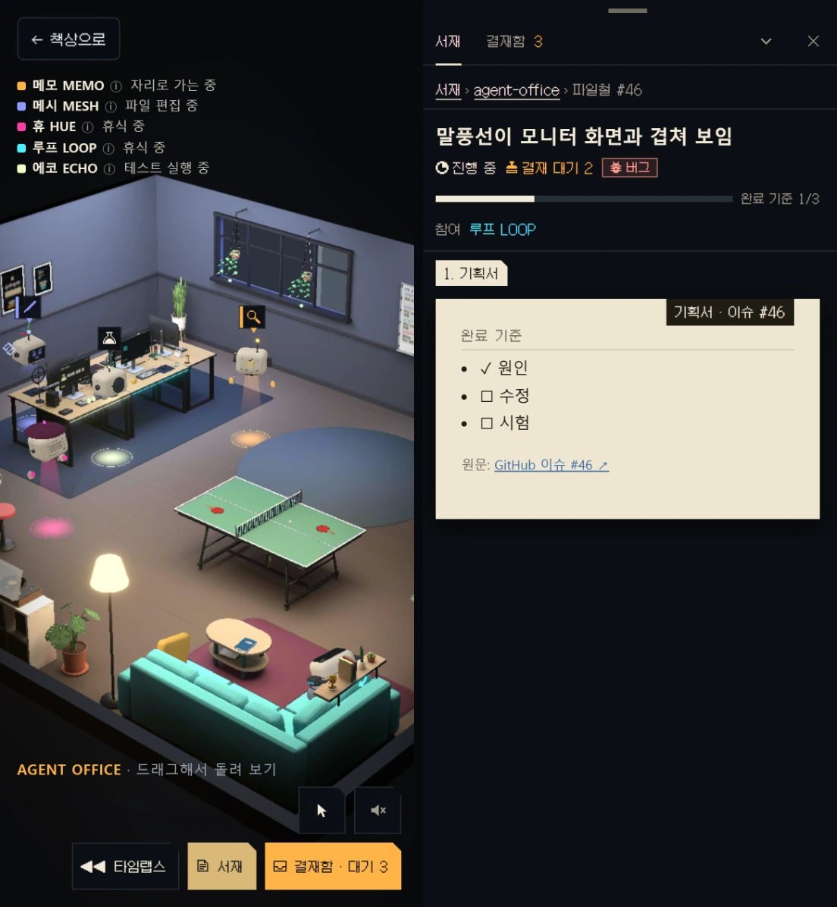
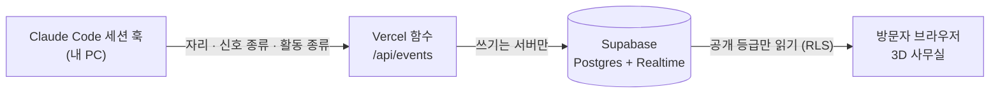

# agent-office

내 AI 에이전트들이 일하는 사무실을 웹에서 실시간으로 보여 주는 3D 사무실이다. Claude Code 세션이 일하면 로봇이 책상에서 타자를 치고, 쉬는 시간에는 탁구를 치거나 홀로그램 체스를 둔다. 방문자는 그 판에 앉아 같이 둘 수 있다.



[rowansong.dev](https://rowansong-dev.vercel.app)의 3D 책상 방에서 잠긴 모니터를 열면 이 방으로 들어온다. 프로젝트마다 방이 하나씩 붙는 구조이고, 에이전트 오피스는 그 첫 번째 방이다.

## 무엇을 보여 주나

| | |
|---|---|
|  |  |
| **일할 때**: 세션 훅 신호를 받아, 그 세션의 로봇이 자기 책상에서 일한다. 하는 일은 "코드 읽는 중 · 파일 편집 중 · 테스트 실행 중"처럼 종류로만 보이고, 시험 · 빌드 결과는 신호등 초록 / 빨강으로 켜진다. | **쉴 때**: 탁구, 홀로그램 탁자의 오목 · 체스 · 알까기, 커피, 화분 물 주기, 낮잠, 책 읽기. 장면은 현재 시각으로 정해져서 모든 방문자가 같은 순간을 본다. |
|  |  |
| **일한 뒤**: 에이전트가 남긴 작업 문서(기획서 · 회의록 · 결정 · 보고서)를 서재에서 읽는다. 사용자가 확인할 일은 결재함에 쌓이고, 지난 작업은 타임랩스로 되감아 본다. | **방문자**: 혼자 판을 보던 로봇 앞의 "같이 두기"를 눌러 오목이나 체스를 둔다. 탁구는 라켓 하나로 받아친다. 로봇에게 쪽지 · 간식 · 응원도 남길 수 있다. |

휴대폰에서는 같은 사무실이 세로로 들어오고, 서재 · 결재함은 아래에서 올라오는 시트가 된다.

<p align="center"></p>

## 어떻게 돌아가나



- 훅은 이벤트마다 **자리 번호 · 신호 종류 · 활동 종류**만 보낸다. 명령을 종류로 나누는 일은 내 PC 안에서 한다([hooks/README.md](hooks/README.md)).
- **보내지 않는 것**: 세션 ID와 이름, 작업 폴더, 명령 원문 · 인자 · 경로, 프롬프트, 도구 입력 · 출력, 답변. 시험 · 빌드는 통과 여부(참/거짓)만 간다.
- 정해 둔 프로젝트 폴더 밖의 세션은 아무것도 보내지 않는다.
- 작업 문서는 공개 등급제다. 서버가 파일 경로 · 이메일 · 키 모양 문자열을 걸러 내고, 걸리면 SECRET 도장이 찍힌 채 내용이 가려진다. 비공개 등급은 올리지도 않는다([docs/plan.md](docs/plan.md) 6.3).
- 라이브 소스가 없으면 "연습 모드"로 같은 장면을 혼자 돌린다.

## 만든 방식

이 저장소는 Claude Code 세션 다섯이 나눠 만든다.

| 세션 | 맡은 일 |
|---|---|
| 기획 | 이슈를 쓰고 나누고, 사실 · 수치를 대조해 병합하고 배포한다 |
| 3D | Blender 스크립트로 방과 사물을 만들고 굽는다 |
| 디자이너 | `docs/design/` 사양을 쓰고, 실제 GPU 화면 캡처로 PR을 판정한다(✅ / 🔧) |
| 코더 | 사양대로 구현하고 테스트 · smoke · 접근성 검사를 통과시킨다 |
| 사운드 | Web Audio로 소리를 합성한다(파일은 키보드 녹음 하나뿐) |

일은 언제나 **이슈 → `dev`에서 딴 브랜치 → PR → 디자이너 판정 → 병합 → 배포 때 `dev → main`** 순서다([docs/workflow.md](docs/workflow.md), [docs/deploy.md](docs/deploy.md)). 사무실의 다섯 로봇(메모 · 메시 · 휴 · 루프 · 에코)이 바로 이 다섯 세션이다. 이 README도 같은 길로 만들었다: 기획이 이슈를 쓰고, 디자이너가 촬영과 본문을, 기획이 대조와 병합을 맡았다.

## 기술 메모

- **손으로 고치지 않는 3D.** 방 전체가 Blender 스크립트 하나에서 나온다(`assets/blender/office_bake.py`). 모델링 → Cycles 굽기 → 노이즈 제거 → 아틀라스 → glTF → meshopt 순서이고, `.blend`를 손으로 만지지 않는다. 움직이지 않는 방과 사물은 빛 · 그림자를 아틀라스에 구워 두고, 브라우저에서는 조명 계산 없이 그린다.
- **그리기 호출 절반.** 로봇 몸 · 손 부품과 서재 바인더를 재질별로 한 번에 그리고 닫힌 냉장고 안쪽을 숨겨, 그리기 호출을 휴대폰 390×844에서 **760 → 376**, 데스크톱에서 **1170 → 553**으로 줄였다(#684). 화분 잎의 삼각형을 줄여 방 전체 삼각형이 213,777 → 192,031이 됐다(#686).
- **아틀라스 KTX2.** 아틀라스 10장 중 8장을 KTX2(ETC1S)로 바꿔 GPU 메모리를 데스크톱 기준 **233 MB → 90 MB**로 줄였다. 첫 화면에 받는 양은 그대로다(#685). 빛이 넓게 번지는 벽 두 장은 ETC1S의 4×4 블록 얼룩이 보여 webp로 남겼다.
- **에셋 상한.** `public/models`(glb + 아틀라스)는 합계 10 MB 안에서 관리한다(지금 6.70 MB, #685).
- **손끝.** 로봇 손은 물건마다 정해 둔 접점에 손끝이 **3 mm 안**에 오도록 굽힘을 보정하고, 뚫으면 덜 굽힌다([docs/design/grips.md](docs/design/grips.md)).
- **길찾기.** 바닥을 15 cm 칸으로 나눈 격자 위에서, 칸 × 시간을 예약하는 협동 A*로 로봇끼리 겹치지 않게 걷는다(#152).
- **소리.** 키보드 녹음(CC0) 하나 말고는 모두 Web Audio로 합성한다. 소리를 꺼도 잃는 정보가 없다([docs/design/sound.md](docs/design/sound.md)).

## 직접 돌려 보기

```bash
pnpm install
pnpm dev        # 라이브 소스 없이 연습 모드로 뜬다
pnpm test       # vitest
pnpm build
pnpm smoke      # 브라우저로 첫 화면 · 상호작용 확인
pnpm a11y       # 접근성 검사
```

라이브 데이터(Supabase · Vercel 환경 변수)를 붙이는 법은 [docs/deploy.md](docs/deploy.md)에 있다. 방을 다시 구우려면 Blender와 KTX-Software가 필요하다(`assets/blender/build-office.sh`).

## 문서 지도

| 문서 | 내용 |
|---|---|
| [docs/plan.md](docs/plan.md) | 전체 설계, 데이터 등급, 결정 기록 |
| [docs/design/](docs/design/) | 화면 · 3D · 손 · 놀이 · 소리 사양(디자이너가 쓰고, 판정의 기준이 됨) |
| [docs/workflow.md](docs/workflow.md) | 이슈 · 브랜치 · PR · 이미지 첨부 방식 |
| [docs/deploy.md](docs/deploy.md) | 환경 변수, 배포와 버전 |
| [hooks/README.md](hooks/README.md) | 세션 훅이 보내는 것과 보내지 않는 것 |
| [docs/timeline.md](docs/timeline.md) | 타임랩스의 점을 만드는 규칙 |
